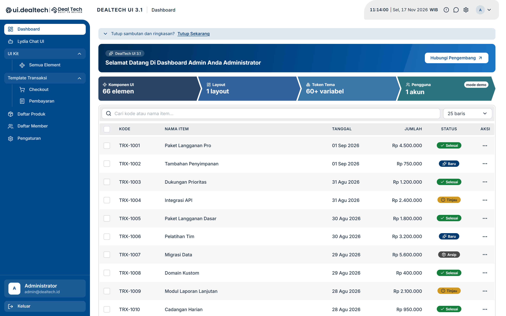
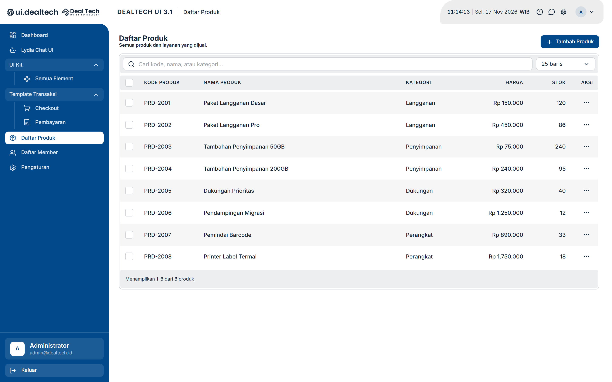
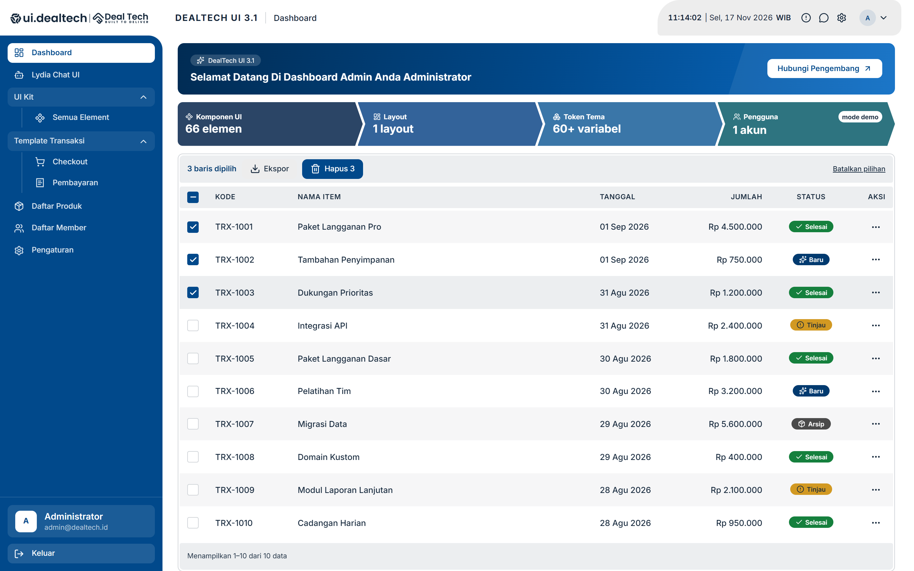
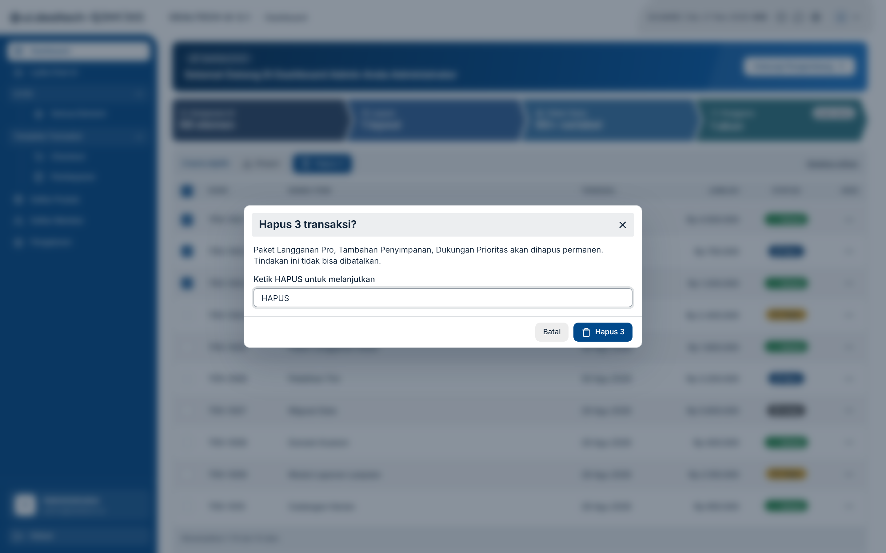
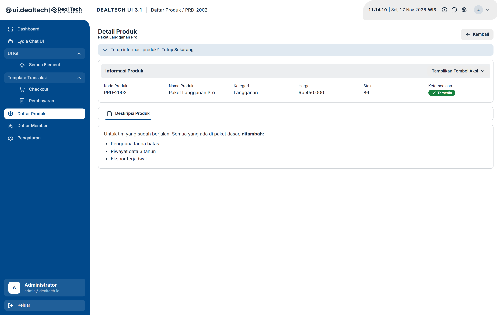
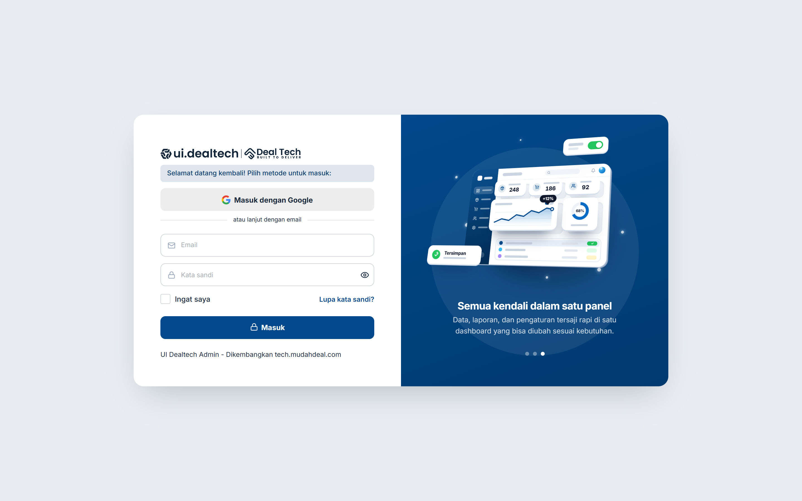

<div align="center">


&nbsp;

&nbsp;


<sub>React 19 · Vite · TypeScript · Tailwind CSS &nbsp;|&nbsp; 66 element di v3.1 &nbsp;|&nbsp; Gratis</sub>

</div>

## DealTech UI

**DealTech UI** adalah CLI untuk memasang starter admin panel siap pakai, lalu menambah UI element atau layout satu per satu ke project React Anda. Satu perintah memberi Anda halaman login, dashboard, tabel, form, chart, pengaturan, dan tema yang sudah rapi.

Pola pakainya mirip shadcn/ui: kode komponen disalin ke project Anda, bukan diimpor dari paket. Anda bebas mengubahnya.

- **Satu perintah**, struktur project, routing, login, dan dashboard langsung jadi
- **Tabel yang rapi**, satu sel satu data, aksi baris lewat dropdown, hapus massal dengan konfirmasi ketik HAPUS
- **Tema dari token**, warna utama bisa diganti dari halaman Pengaturan tanpa menyentuh kode
- **Siap untuk AI**, starter membawa `AGENTS.md` sehingga Claude Code, Codex, dan Cursor mengikuti aturan tampilan yang sama
- **Ambil seperlunya**, `add tablelist-v1` ikut membawa `button`, `checkbox`, dan `pagination` bila belum ada

<p align="center">
  
</p>

<p align="center"><sub>Dashboard starter v3.1</sub></p>

## Yang Baru di v3.1

<table>
  <tr>
    <td width="50%" valign="top">
      <h3>Rata, tanpa bayangan</h3>
      Kartu, seksi, tabel, chart, dan isian form cukup memakai border. Bayangan hanya tersisa di elemen yang melayang, seperti modal, dropdown, dan tooltip. Semuanya diatur dari satu token di <code>theme.css</code>.
    </td>
    <td width="50%" valign="top">
      <h3>Bar abu yang seragam</h3>
      Header tabel, bar cari, bar aksi massal, footer paginasi, kepala seksi, dan kepala modal memakai bar abu yang sama. Tinggi toolbar dan footer sama persis, jadi tabel tidak bergeser saat baris dipilih.
    </td>
  </tr>
  <tr>
    <td width="50%" valign="top">
      <h3>Hapus massal yang aman</h3>
      Element <code>hapus-massal</code> dan <code>konfirmasi-modal</code> meminta pengguna mengetik HAPUS sebelum data dihapus. Baris yang gagal dihapus tetap terpilih, lengkap dengan alasannya.
    </td>
    <td width="50%" valign="top">
      <h3>Kartu statistik chevron</h3>
      Segmen kartu saling mengunci seperti panah, warnanya mengikuti kolom, dan paling banyak lima per baris. Nilainya bisa tampil sebagai skeleton saat data belum datang.
    </td>
  </tr>
  <tr>
    <td width="50%" valign="top">
      <h3>Element baru</h3>
      <code>seksi</code> untuk kartu berjudul, <code>bidang</code> untuk label kontrol tanpa label, <code>tombol-muat-ulang</code> untuk Refresh beranimasi, dan hook <code>useAksiTuang</code> untuk tombol async.
    </td>
    <td width="50%" valign="top">
      <h3>Lebih padu</h3>
      Isian setinggi tombol dan butir menu sidebar, tab dan kolom cari punya gaya pil, animasi tombol tuang dua kali lebih cepat, dan Esc menutup dropdown dulu sebelum modal.
    </td>
  </tr>
</table>

## Tampilan

<table>
  <tr>
    <td width="50%"></td>
    <td width="50%"></td>
  </tr>
  <tr>
    <td align="center"><sub>Daftar produk: bar cari, header, dan footer abu</sub></td>
    <td align="center"><sub>Pilih baris: bar massal menggantikan bar cari</sub></td>
  </tr>
  <tr>
    <td width="50%"></td>
    <td width="50%"></td>
  </tr>
  <tr>
    <td align="center"><sub>Konfirmasi ketik HAPUS</sub></td>
    <td align="center"><sub>Detail produk dengan <code>Seksi</code></sub></td>
  </tr>
  <tr>
    <td colspan="2"></td>
  </tr>
  <tr>
    <td colspan="2" align="center"><sub>Halaman login dengan adegan dashboard 3D</sub></td>
  </tr>
</table>

## Mulai Sekarang

```bash
npx dealtech-ui-v3.1 install my-admin-app
cd my-admin-app
npm run dev
```

Perintah `install` membuat folder project, menyalin starter, lalu menjalankan `npm install`. Masuk dengan email dan kata sandi apa saja, karena starter berjalan dalam mode demo sampai backend Anda siap.

Tambah element atau layout ke project yang sudah ada:

```bash
npx dealtech-ui-v3.1 add tablelist-v1 hapus-massal seksi
npx dealtech-ui-v3.1 add-layout admin-layout
npx dealtech-ui-v3.1 add-page reports
```

| Perintah | Fungsi |
|---|---|
| `install [nama]` | Starter admin panel lengkap |
| `add <element...>` | Salin UI element beserta element lain yang dibutuhkannya ke `src/components/ui/` |
| `add-layout admin-layout` | Salin layout admin beserta tema, font, dan berkas menu |
| `add-page <nama>` | Buat `src/pages/<nama>/<Nama>Page.tsx` dan daftarkan rute `/dashboard/<nama>` |
| `help` | Daftar element yang tersedia di starter aktif |

Bendera: `--no-install` melewati `npm install`, `--force` menimpa berkas yang sudah ada.

## Pilih Starter

Nama perintah menentukan starter yang dipakai. **v3.1 adalah versi terbaru** dan yang disarankan untuk project baru.

| Perintah | Starter | Gaya | Element |
|---|---|---|---|
| `dealtech-ui-v3.1` | `templates/starter-v3.1` | **v3.1 (terbaru)**: tanpa bayangan, bar abu, Seksi, hapus massal | 66 |
| `dealtech-ui-v3` | `templates/starter-v3.0` | v3.0: element v2 + tombol tuang, shell dan tema baru | 61 |
| `dealtech-ui-v2-next` | `templates/starter-v2.0-next` | v2.0-next: token CSS, satu berkas CSS per komponen | 58 |
| `dealtech-ui` | `templates/starter` | v1: Tailwind inline | 29 |

Bendera `--v1`, `--v2`, `--v3`, dan `--v3.1` menimpa pilihan dari nama perintah, misalnya saat menguji lewat `npm link`:

```bash
npx dealtech-ui install my-admin-app --v3.1
npx dealtech-ui add tablelist-v1 --v3.1
```

<details>
<summary><b>Bedanya di mana</b></summary>

<br>

**v1 dan v2/v3 memakai set element yang berbeda.** Nama folder, API prop, dan cara styling-nya tidak saling kompatibel:

| | v1 | v2.0-next, v3.0, v3.1 |
|---|---|---|
| Styling | class Tailwind inline di dalam TSX | token CSS di `src/styles/theme.css` + satu berkas CSS per komponen |
| Penamaan folder | rapat, campur Inggris (`actionbutton`, `searchinput`) | ber-tanda hubung, sebagian Indonesia (`action-button`, `search-input`) |
| Impor antar komponen | jalur relatif (`../button/Button`) | alias (`@/components/ui/button/Button`) |
| Chart | tidak ada | 10 element berbasis `recharts` |
| Font | dari CDN | di-bundel di `src/styles/fonts` |

Karena itu nama element v1 tidak dikenali di v2/v3 dan sebaliknya. CLI menolak nama yang tidak ada di starter aktif dan menampilkan daftar yang tersedia.

**v3.1 dibanding v3.0:** semua element v3.0 ada di v3.1. Bedanya ada di tampilan (token tanpa bayangan, bar abu, kartu statistik chevron, tinggi isian) dan lima element baru: `seksi`, `bidang`, `konfirmasi-modal`, `hapus-massal`, `tombol-muat-ulang`. Rinciannya ada di [CHANGELOG](CHANGELOG.md).

**v3.0 dibanding v2.0-next:** element-nya nyaris sama. Yang berbeda terutama kulit aplikasinya: halaman login dan lupa sandi baru, halaman maintenance, Lydia Chat UI, warna tema yang bisa diganti dari Pengaturan, header bergaya dokumen, dan sidebar biru. Khusus v3: `tombol-tuang`, `kode-otp`, `skeleton`.

</details>

<details>
<summary><b>Daftar element</b></summary>

<br>

**v3.1** (`dealtech-ui-v3.1`)

`action-button`, `badge`, `badgeinfo`, `badgev2`, `bidang`, `bilah-lipat`, `blok-tentang`, `button`, `cardbar-chart`, `cardbar-list`, `chartbar-ganda`, `chartbarhor`, `chartbarver`, `chartline`, `chartlinev2`, `chartlistbar`, `chartpie`, `charttoplist`, `checkbox`, `date-input`, `hapus-massal`, `heatmap`, `hex-backdrop`, `inputlongtext`, `inputnumber`, `inputtext`, `kalender`, `kartu-katalog`, `kartu-paket`, `kepala-publik`, `kode-otomatis`, `kode-otp`, `konfirmasi-modal`, `label-qr`, `lembar-cetak`, `lightbox`, `logo-shape`, `memuat`, `menu-aksi`, `modal`, `modal-galat`, `pagetitle`, `pagination`, `peta-titik`, `pilih-banyak`, `pita-berjalan`, `progress-bar`, `proses-modal`, `protected-route`, `richtext`, `search-input`, `search-select`, `seksi`, `select`, `skeleton`, `stat-card`, `tab-button`, `tabelcardv1`, `table-toolbar`, `tablelist-v1`, `toggleonoff`, `tombol-muat-ulang`, `tombol-tuang`, `ulasan-berjalan`, `unggah-gambar`, `welcome-card-v2`

v3.0 sama dengan v3.1 tanpa `bidang`, `hapus-massal`, `konfirmasi-modal`, `seksi`, dan `tombol-muat-ulang`. v2.0-next sama dengan v3.0 tanpa `tombol-tuang`, `kode-otp`, dan `skeleton`.

**v1** (`dealtech-ui`)

`actionbutton`, `badge`, `button`, `cardtabelv1`, `confirmmodal`, `filterselect`, `formmodal`, `infosection`, `input`, `inputdate`, `kartupaket`, `longtextinput`, `modal`, `notecard`, `pageheader`, `pagination`, `plancard`, `progresbarv1`, `progresbarv2`, `progresbarv3`, `scroltotop`, `searchableselect`, `searchinput`, `statcardoverview`, `tabledata-v1`, `tabledata-v2`, `timelinetabel`, `uploadfield`, `welcomecard`

Tanda hubung boleh dilepas: `add searchselect` sama dengan `add search-select`. Daftar paling mutakhir selalu bisa dilihat lewat `npx dealtech-ui-v3.1 help`.

**Layout:** `admin-layout` (alias `admin`), tersedia di semua starter. Di v2 dan v3 ikut tersalin `theme.css`, font, dan berkas menu.

</details>

## Aturan untuk AI

Starter v3.0 dan v3.1 membawa `AGENTS.md` (dan `CLAUDE.md` yang mengimpornya), sehingga asisten AI di project hasil `install` mengikuti aturan tampilan yang sama:

- **Tabel**: satu sel satu data, isi satu baris dengan elipsis, aksi baris lewat dropdown `AksiBaris`, hapus massal lewat `HapusMassal`.
- **Kartu**: tanpa bayangan, cukup border; kartu berjudul memakai `Seksi`.
- **Keterangan**: selalu `BadgeInfo` tanpa ikon, ukuran teks tidak ditimpa.
- **Loading**: skeleton yang meniru susunan halaman, bukan spinner.
- **Tombol async**: `TombolTuang` + `useAksiTuang`, tanpa popup "berhasil".
- **Warna**: lewat token tema, tidak menulis hex merek langsung.

## Dibangun Dengan

<p align="center">
  &nbsp;
  &nbsp;
  &nbsp;
  &nbsp;
  
</p>

<p align="center"><sub>React · React Router · Vite · TypeScript · Tailwind CSS · Recharts · lucide-react · Font Inter</sub></p>

<details>
<summary><b>Untuk developer</b></summary>

<br>

Jalankan CLI dari clone lokal:

```bash
git clone https://github.com/mrizky-fr/dealtech-ui.git
cd dealtech-ui
npm link
```

Lalu dari folder lain:

```bash
dealtech-ui install demo-app --v3.1
dealtech-ui add badge --v3.1
dealtech-ui add-layout admin-layout --v3.1
```

Setiap starter adalah project Vite biasa. Untuk mengembangkan starter-nya sendiri:

```bash
cd templates/starter-v3.1
npm install
npm run dev      # http://localhost:5175
npm run build    # tsc --noEmit lalu vite build
```

`install` tidak ikut menyalin `node_modules`, `dist`, `.vite`, dan `.git` milik folder template.

| Folder | Isi |
|---|---|
| `cli/install.js` | Satu berkas CLI: `install`, `add`, `add-layout`, `add-page`, `help`. Starter dipilih dari nama perintah atau bendera. |
| `templates/starter-v3.1` | Starter terbaru. |
| `templates/starter-v3.0` | Starter v3.0, tetap dipasang oleh `dealtech-ui-v3`. |
| `templates/starter-v2.0-next` | Starter v2.0-next. |
| `templates/starter` | Starter v1. |
| `docs/` | Tangkapan layar README. |

`add-page` mengikuti gaya impor berkas router yang ada (alias `@/pages/...` atau relatif `../pages/...`), jadi aman dijalankan di project yang sudah berpindah gaya.

</details>

## Catatan

Starter berjalan dalam **mode demo** (`MODE_DEMO` di `src/lib/demo.ts`): login, lupa sandi, Lydia Chat, dan pengaturan disimulasikan di browser. Setel `MODE_DEMO` ke `false` dan isi `VITE_API_URL` di `.env` saat backend siap. Kunci API apa pun tetap di backend, tidak di frontend. Riwayat perubahan lengkap ada di [CHANGELOG.md](CHANGELOG.md). Font Inter dipakai di bawah SIL Open Font License.

## Pembuat

Dibuat oleh **M Rizky** (Kyy) untuk [Deal-Tech](https://tech.mudahdeal.com).

[](https://github.com/mrizky-fr)
[](https://github.com/mrizky-fr/dealtech-ui)
[](https://tech.mudahdeal.com)


